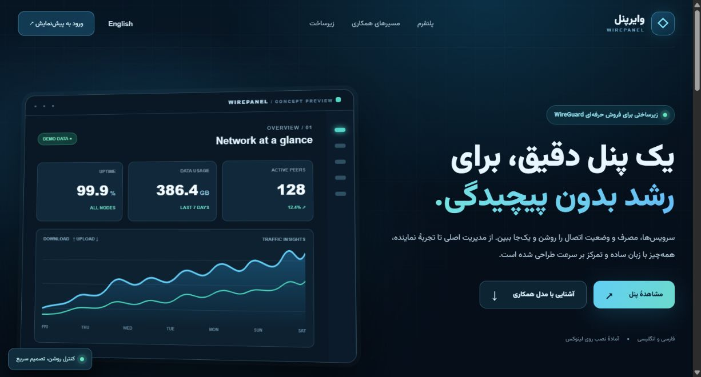
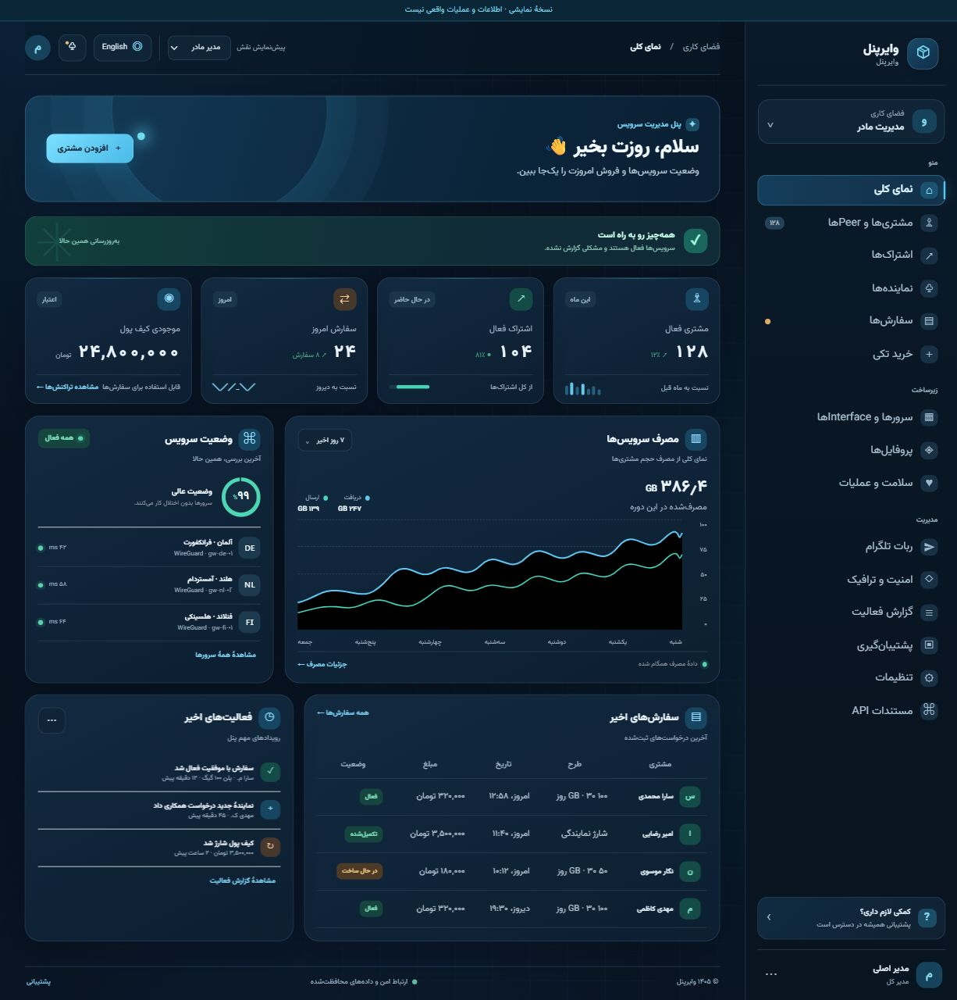
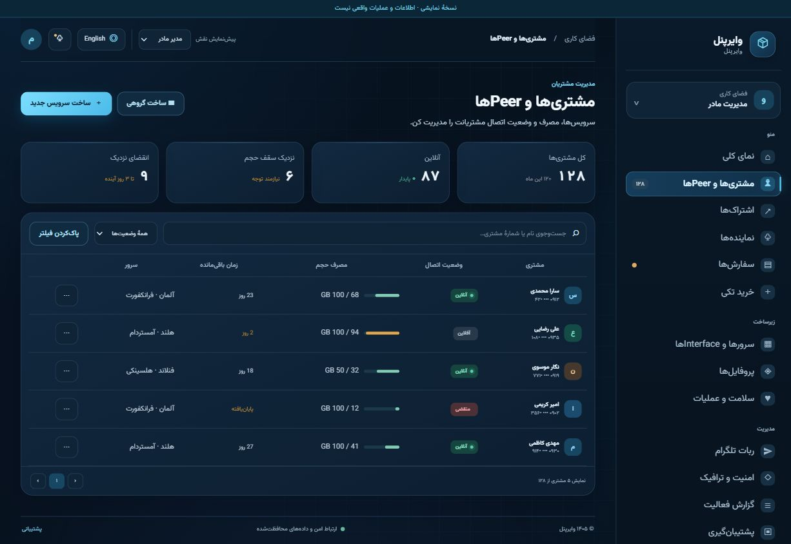
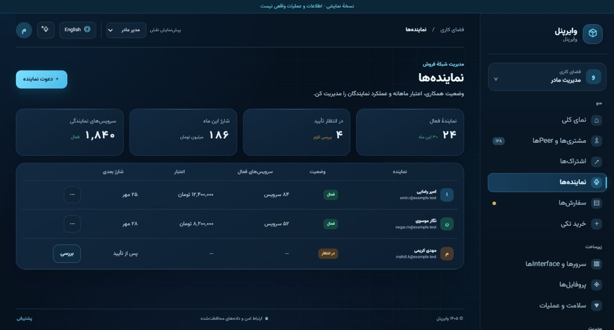
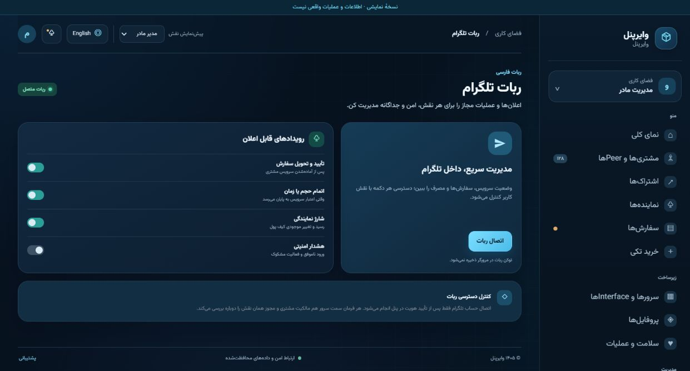

# WG Portal

Persian/English interactive portal for WireGuard administrators, resellers, and single-order partners.

## پیش‌نمایش تصویری

تصاویر زیر از نسخهٔ نمایشی سایت گرفته شده‌اند. نام‌ها، مصرف و مبلغ‌ها نمونه هستند؛ بخش‌های فروش، نمایندگی و ربات تلگرام در این تصاویر پیش‌نمایش رابط کاربری‌اند و هنوز به سرویس فروش واقعی وصل نشده‌اند.

**صفحهٔ معرفی**



**داشبورد و نمودار مصرف**



**بخش‌های پنل** — برای دیدن تصویر بزرگ‌تر، روی آن کلیک کنید.

| مشتری‌ها و Peerها | نماینده‌ها | ربات تلگرام |
| --- | --- | --- |
| [](docs/images/03-peers.jpg) | [](docs/images/04-resellers.jpg) | [](docs/images/05-telegram.jpg) |

## نصب سریع روی VPS لینوکسی

مخزن **خصوصی** است. تأیید اثرانگشت `github.com` فقط هویت سرور GitHub را تأیید می‌کند و به VPS اجازهٔ خواندن مخزن نمی‌دهد. برای رفع خطای `Permission denied (publickey)`، روی VPS یک کلید مخصوص همین مخزن بسازید (اگر فایل هم‌نام از قبل وجود دارد، آن را بازنویسی نکنید):

```bash
install -d -m 700 /root/.ssh
ssh-keygen -t ed25519 -f /root/.ssh/wg_portal_deploy -C "wg-portal-vps" -N ''
chmod 600 /root/.ssh/wg_portal_deploy
cat /root/.ssh/wg_portal_deploy.pub
```

**فقط متن کلید عمومی** که دستور آخر چاپ می‌کند را در تنظیمات همین مخزن، [Settings → Deploy keys](https://github.com/ashkanfthy97-alt/WG-Panel-Reseller/settings/keys)، با گزینهٔ **Allow write access خاموش** ثبت کنید. کلید خصوصی (فایل بدون پسوند `.pub`) را جایی ارسال نکنید. روی VPS اجرا کنید:

```bash
GIT_SSH_COMMAND='ssh -i /root/.ssh/wg_portal_deploy -o IdentitiesOnly=yes' git ls-remote git@github.com:ashkanfthy97-alt/WG-Panel-Reseller.git HEAD
GIT_SSH_COMMAND='ssh -i /root/.ssh/wg_portal_deploy -o IdentitiesOnly=yes' git clone git@github.com:ashkanfthy97-alt/WG-Panel-Reseller.git && bash WG-Panel-Reseller/deploy/linux/install.sh --managed
```

اگر دستور `ls-remote` خطا داد، پیش از نصب [عیب‌یابی دسترسی SSH](deploy/linux/README.fa.md) را بخوانید. نصب‌کننده بسته‌های Ubuntu/Debian، محیط مجازی Python و سرویس‌های systemd را خودش آماده می‌کند؛ **Docker لازم نیست**. اگر مخزن را قبلاً در `/root/WG-Panel-Reseller` گرفته‌اید، با یک دستور به‌روزرسانی و نصب کنید:

```bash
GIT_SSH_COMMAND='ssh -i /root/.ssh/wg_portal_deploy -o IdentitiesOnly=yes' git -C /root/WG-Panel-Reseller pull --ff-only && bash /root/WG-Panel-Reseller/deploy/linux/install.sh --managed
```

اگر WG_Panel از قبل روی همین سرور اجرا می‌شود، دستور `bash WG-Panel-Reseller/deploy/linux/install.sh --existing-port 8000` را با پورت واقعی محلی پنل اجرا کنید. پرتال روی `127.0.0.1:8765` و پنل نصب تازه روی `127.0.0.1:8766` اجرا می‌شوند؛ پورت `443` اشغال نمی‌شود. پیش از دسترسی عمومی، مراحل ساخت حساب مدیر، اتصال دامنه، HTTPS، فایروال و پشتیبان‌گیری را در [راهنمای قدم‌به‌قدم فارسی](deploy/linux/README.fa.md) انجام دهید. هیچ رمز یا توکن ادمین در این مخزن قرار ندارد.

## Current stage

The hosted Sites edition remains a private frontend preview with local demo data. `/` is the bilingual product introduction and `/app.html` is the dashboard preview. Do not enter real credentials, customer data, private keys, or bot tokens into it. The [Linux package](deploy/linux/README.fa.md) can serve the same dark UI alongside an existing or pinned upstream WG_Panel. In that mode, the overview, cumulative usage chart, and peer directory read authenticated live data, and `/users` provides the upstream operational panel. Reseller commerce, payments, Telegram integration, and n8n remain future backend work.

## Site runtime and ports

The Sites frontend is hosted separately and does not bind a port on the user's VPS. The native Linux package installs Python services through systemd, binds the portal to `127.0.0.1:8765` and, for a managed upstream panel, binds WG_Panel to `127.0.0.1:8766`. It leaves 443 and n8n listeners untouched. A trusted HTTPS reverse proxy is required for external access. A nonstandard port is not a security boundary. n8n should eventually connect through an authenticated hostname/API or a verified webhook; credentials belong in server-side secret storage.

The [step-by-step Linux runbook](deploy/linux/README.fa.md) covers VPS and DNS prerequisites, first-admin registration, TOTP, HTTPS, WireGuard interfaces, and the optional upstream Telegram bot. The only intended initial administrator is `ashkanfthy97@gmail.com`; its password and setup token are entered on the server and are never committed to this repository.

## Product modules represented in the navigation

Overview, customers/peers, subscriptions, reseller panel, one-off orders, WireGuard interfaces, nodes, profiles, health/operations, audit logs, backup/restore, security, traffic policies, Telegram, settings, and API documentation.

## Integration requirements before production

- Add tenant ownership and role-scoped authorization to the backend; never rely on hidden navigation or client-side role selection.
- Replace the current single-admin identity model with administrator, full-panel reseller, and approved order-only partner identities.
- Keep WG_Panel as a WireGuard execution adapter behind a narrow service API. Do not expose its broad shared API key to browsers or third parties.
- Add an auditable credit ledger, idempotent order/recharge operations, expiry/renewal jobs, and safe provisioning compensation.
- Run the Persian Telegram bot as a separate long-lived service next to the backend. Use allowlisted chat/user identities and scoped commands for each role.
- Add database migrations, per-tenant isolation, rate limits, abuse controls, operational monitoring, tested backup/restore, and security review before live sales.

## Visual direction

Midnight navy surfaces, restrained electric blue and teal highlights, a lightweight animated network grid, Persian RTL by default, English LTR on request, responsive layouts, and reduced-motion support. The operational feature set is inspired by the public [WG_Panel repository](https://github.com/Azumi67/WG_Panel), while this interface uses its own structure and styling.
